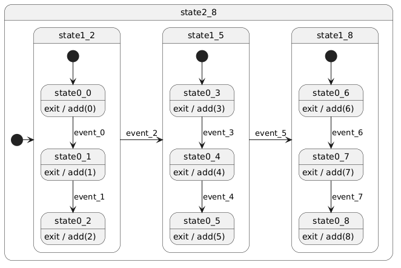
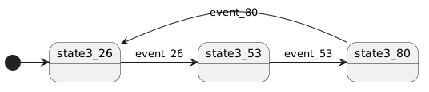

This repository aims to benchmark various C++ FSM (Finite State Machine) libraries.

Tested libraries are:

* [Maki](https://github.com/fgoujeon/maki);
* [Boost](https://www.boost.org/).MSM (with its `back` and `backmp11` back ends);
* [\[Boost::ext\].SML](https://boost-ext.github.io/sml/).

**Disclaimer**:

* I'm the author of Maki.
* I've tried my best to make the test as fair as possible for every library. However, since I'm only an expert in my own library, I might have done mistakes. Please feel free to check the implementations and contact me if something has to be fixed.
* Keep in mind that this is only a single test. Different benchmarks may (or may not) give different results.


## Results

### Visual Studio

* Hardware: AMD Ryzen 5 1600, 8 GiB RAM
* System: Windows 10
* Compiler: Visual Studio 2022

```batch
python run-benchmarks.py %BUILD_DIR% 3 -G "Visual Studio 17 2022" -A "x64" -D FSMB_MSM_INCLUDE_DIR=%BOOST_INCLUDE_DIR% -D FSMB_FORCED_CXX_STANDARD=20
```

Large FSM (best of 3 runs):
|                             | Build time | Execution time | Binary size |
|-----------------------------|-----------:|---------------:|------------:|
| **Maki** 2.0.2              | 6.253 s    | 1.030 s        | 20.5 KiB    |
| **MSM** 1.92.0              | 25.191 s   | 1.490 s        | 59.0 KiB    |
| **MSM (`backmp11`)** 1.92.0 | 6.125 s    | 1.576 s        | 22.0 KiB    |
| **SML** 1.2.0               | 11.390 s   | 1.599 s        | 43.0 KiB    |

Deep FSM (best of 3 runs):
|                             | Build time | Execution time | Binary size |
|-----------------------------|-----------:|---------------:|------------:|
| **Maki** 2.0.2              | 20.062 s   | 0.568 s        | 40.0 KiB    |
| **MSM** 1.92.0              | 185.044 s  | 5.807 s        | 391.5 KiB   |
| **MSM (`backmp11`)** 1.92.0 | 29.421 s   | 1.093 s        | 63.0 KiB    |
| **SML** 1.2.0               | 26.819 s   | 3.565 s        | 422.5 KiB   |


### GCC

* Hardware: AMD Ryzen 7 7800X3D, 32 GiB RAM
* System: Linux 7.2.4-arch1-2
* Compiler: GCC 16.2.1 20260810

```bash
CXX=g++ python run-benchmarks.py ${BUILD_DIR} 3 -D CMAKE_BUILD_TYPE=Release -D FSMB_MSM_INCLUDE_DIR=${MSM_INCLUDE_DIR} -D FSMB_FORCED_CXX_STANDARD=20
```

Large FSM (best of 3 runs):
|                             | Build time | Execution time | Binary size |
|-----------------------------|-----------:|---------------:|------------:|
| **Maki** 2.0.2              | 1.307 s    | 0.273 s        | 25.3 KiB    |
| **MSM** 1.92.0              | 5.829 s    | 1.048 s        | 336.8 KiB   |
| **MSM (`backmp11`)** 1.92.0 | 1.201 s    | 0.502 s        | 38.5 KiB    |
| **SML** 1.2.0               | 2.664 s    | 0.270 s        | 96.0 KiB    |

Deep FSM (best of 3 runs):
|                             | Build time | Execution time | Binary size |
|-----------------------------|-----------:|---------------:|------------:|
| **Maki** 2.0.2              | 4.778 s    | 0.010 s        | 21.0 KiB    |
| **MSM** 1.92.0              | 29.074 s   | 0.895 s        | 2129.9 KiB  |
| **MSM (`backmp11`)** 1.92.0 | 5.931 s    | 0.357 s        | 174.4 KiB   |
| **SML** 1.2.0               | 14.969 s   | 0.334 s        | 2936.9 KiB  |


### Clang

* Hardware: AMD Ryzen 7 7800X3D, 32 GiB RAM
* System: Linux 7.2.4-arch1-2
* Compiler: Clang 23.1.1

```bash
CXX=clang++ python run-benchmarks.py ${BUILD_DIR} 3 -D CMAKE_BUILD_TYPE=Release -D FSMB_MSM_INCLUDE_DIR=${MSM_INCLUDE_DIR} -D FSMB_FORCED_CXX_STANDARD=20
```

Large FSM (best of 3 runs):
|                             | Build time | Execution time | Binary size |
|-----------------------------|-----------:|---------------:|------------:|
| **Maki** 2.0.2              | 1.611 s    | 0.179 s        | 34.9 KiB    |
| **MSM** 1.92.0              | 4.943 s    | 1.014 s        | 387.6 KiB   |
| **MSM (`backmp11`)** 1.92.0 | 1.170 s    | 0.448 s        | 45.8 KiB    |
| **SML** 1.2.0               | 3.612 s    | 0.919 s        | 679.2 KiB   |

Deep FSM (best of 3 runs):
|                             | Build time | Execution time | Binary size |
|-----------------------------|-----------:|---------------:|------------:|
| **Maki** 2.0.2              | 5.972 s    | 0.061 s        | 70.2 KiB    |
| **MSM** 1.92.0              | 24.683 s   | 1.424 s        | 1993.9 KiB  |
| **MSM (`backmp11`)** 1.92.0 | 7.163 s    | 0.305 s        | 137.1 KiB   |
| **SML** 1.2.0               | 11.095 s   | 0.600 s        | 3812.7 KiB  |


## Benchmarks Specifications

### Large FSM

This benchmark tries to mimic a real-life large FSM. It consists of:

* an `int counter`;
* a large FSM:
  * which defines:
    * 25 states (*state<sub>0</sub>* to *state<sub>24</sub>*);
    * 25 event types for state transitions (*sevent<sub>0</sub>* to *sevent<sub>24</sub>*) that contain an `int two = 2`;
    * 1 event type for internal transitions (*ievent*) that contains an `int two = 2`;
    * 25 state transition actions (*saction<sub>0</sub>* to *saction<sub>24</sub>*) doing `counter = (counter + 1) * event.two`;
    * 25 internal transition actions (*iaction<sub>0</sub>* to *iaction<sub>24</sub>*) doing `counter /= event.two`;
    * 25 state exit actions (*eaction<sub>0</sub>* to *eaction<sub>24</sub>*) making the FSM process *ievent* (in order to test run-to-completion);
    * 25 guards;
  * whose initial state is *state<sub>0</sub>*;
  * which transitions from *state<sub>n</sub>* to *state<sub>(n+1)%25</sub>* and executes *saction<sub>n</sub>* whenever it receives *sevent<sub>n</sub>* and *guard<sub>n</sub>* returns true;
  * which executes *iaction<sub>n</sub>* whenever it receives *ievent* in *state<sub>n</sub>*;
  * whose all guards check that the event data is positive (effectively returning `true` every time);
* a `test()` function that:
  * creates the counter;
  * creates the FSM;
  * makes the FSM perform 25 state transitions from *state<sub>0</sub>* to *state<sub>24</sub>* and back to *state<sub>0</sub>*, 1000 times;
  * returns the value of the counter;
* a `main()` function that calls the `test()` function 1,000 times and checks that the counter has the expected value.


### Deep FSM

This benchmark shall define an FSM with 4 levels of states:

* the FSM shall contain three level-3 composite states;
* each level-3 composite state shall contain three level-2 composite states;
* each level-2 composite state shall contain three level-1 composite states;
* each level-1 composite state shall contain three level-0 simple states.

We then have a total of:

* 81 level-0 states, labelled ${state0}_n$ with $`n=\{0,1,2,...,80\}`$;
* 27 level-1 states, labelled ${state1}_n$ with $`n=\{2,5,8,...,80\}`$;
* 9 level-2 states, labelled ${state2}_n$ with $`n=\{8,17,26,...,80\}`$;
* 3 level-3 states, labelled ${state3}_n$ with $`n=\{26,53,80\}`$.

Every ${state0}_n$ shall define an exit action that adds $n$ to a global counter.

The FSM shall also define transitions for every ${event}_n$. The intended effect of ${event}_n$ is to:

* make the FSM transition from ${state0}_n$ to $`{state0}_{n+1}`$ (possibly through higher-order transitions);
* consequently, add $n$ to the global counter.

Actually, the subscript $n$ of a state, whatever its level, defines the ${event}_n$ that makes the FSM exit the said state.

The diagram below, which represents the first level-2 state, shows the required transitions:



At the top level, level-3 states are laid out like so:



The benchmark shall define a `test()` function that:

* creates the counter;
* creates the FSM;
* executes a process loop 1,000 times.

The process loop shall make the FSM process all ${event}_n$ from $n=0$ to $n=80$ once.

The benchmark shall invoke the `test()` function 500 times and check that the counter has the expected value.


## Note

Each program is required to enable run-to-completion. This implies that FSM libraries that don't support run-to-completion can't take part in this benchmark.
